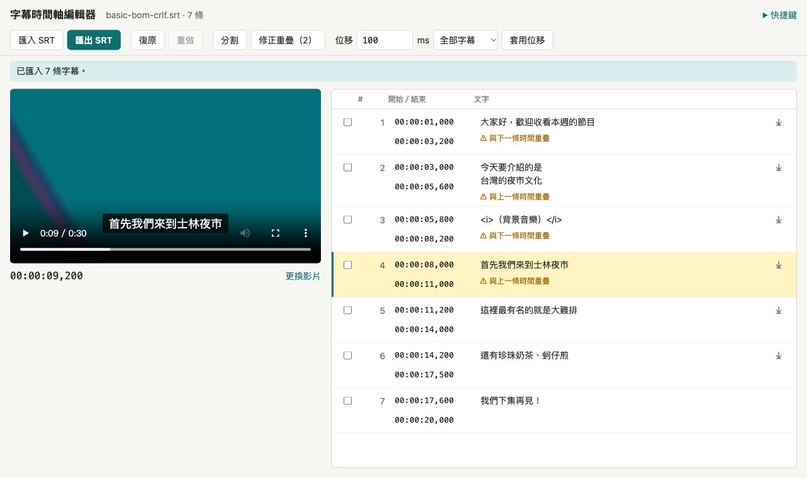
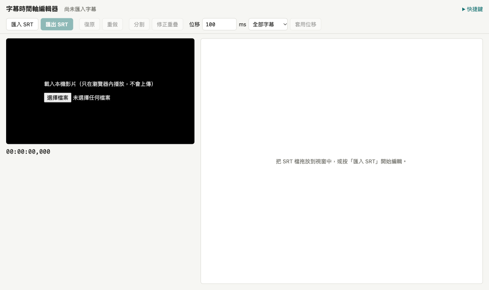
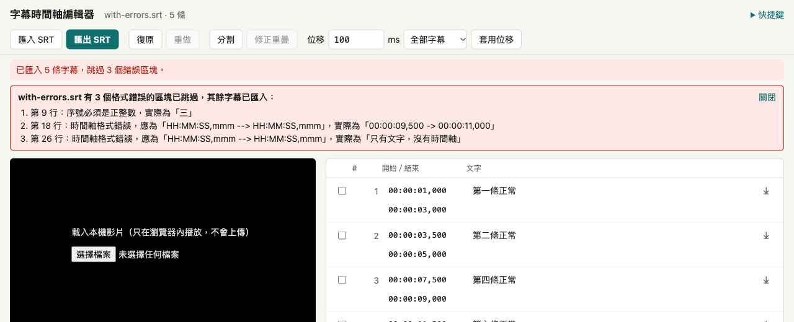
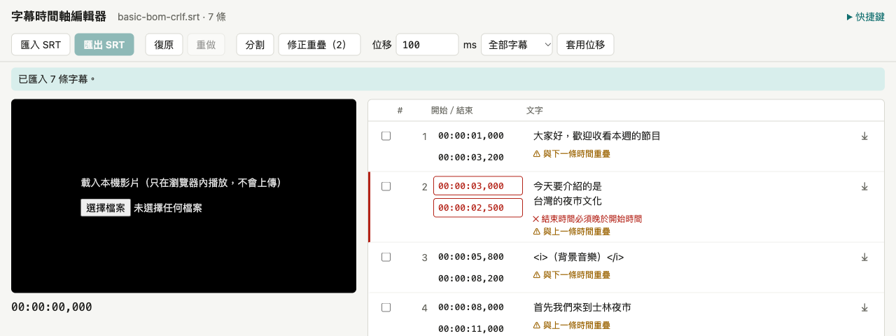
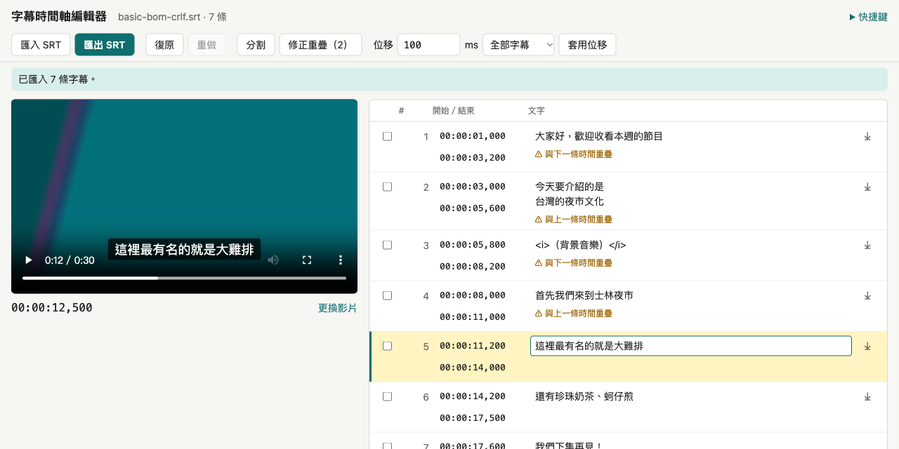
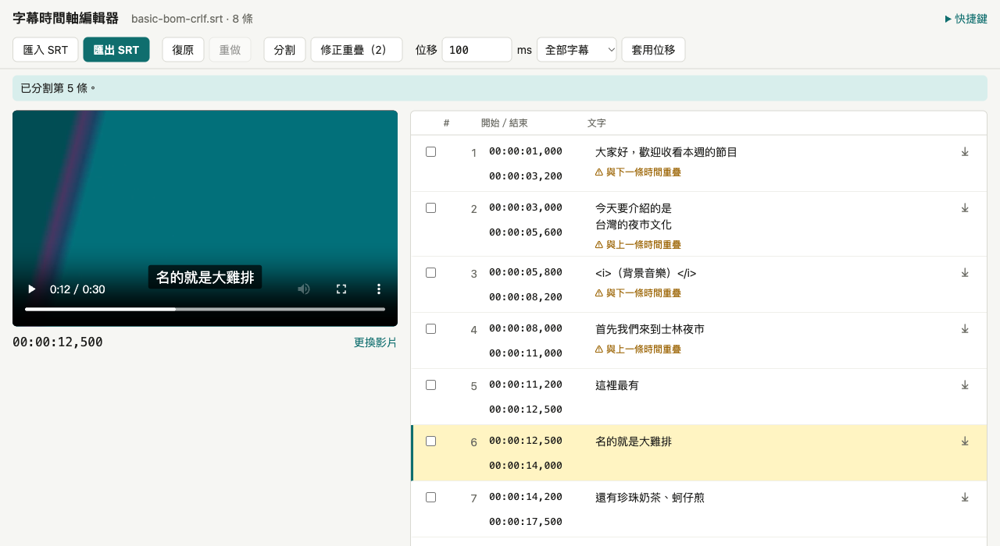
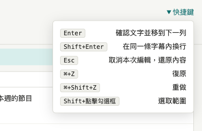

# 字幕時間軸編輯器（Subtitle Timeline Editor）

打開瀏覽器就能用的 SRT 字幕編輯工具：修正整段時間偏移、字幕重疊，對著影片逐條校對。純前端，影片與字幕都不會離開你的電腦。

**線上 Demo：** https://hn83320589.github.io/subtitle-timeline-editor/



## 啟動方式

需要 Node.js 20.19 以上（Vite 8 的需求）。

```bash
npm install
npm run dev        # 開發伺服器，預設 http://localhost:5173
```

其他指令：

| 指令 | 用途 |
| --- | --- |
| `npm test` | 執行所有 Vitest 測試 |
| `npm run test:watch` | 監看模式 |
| `npm run typecheck` | TypeScript 型別檢查 |
| `npm run lint` | oxlint |
| `npm run build` | 產生正式版到 `dist/` |
| `npm run gen:samples` | 重新產生 `samples/` 下的範例檔 |

推送到 `main` 後，GitHub Actions 會依序執行 lint、測試、build，然後部署到 GitHub Pages（`.github/workflows/deploy.yml`）。

## 操作說明

### 1. 匯入字幕

打開頁面後，按工具列的「**匯入 SRT**」選擇檔案，或直接把 `.srt` 檔拖放到視窗中任何位置。



- 支援 UTF-8（含 BOM），CRLF 與 LF 換行都可以。
- **格式錯誤的區塊會被跳過**，其餘字幕照常匯入。畫面上方會列出每個錯誤在原檔的行號與原因，方便回原檔對照；按「關閉」可以收起清單。
- 匯入新檔也算一步，誤匯入時按「復原」可以回到原本的內容。



> 試用：`samples/with-errors.srt` 有 3 個刻意寫錯的區塊。

### 2. 載入影片

在左側黑色區域按「選擇檔案」載入本機影片，也可以把影片檔拖放到視窗中。影片只在瀏覽器內播放，**不會上傳**。之後可以按影片下方的「更換影片」換成別的檔案。

- 播放時，右側列表會**高亮目前的字幕**並自動捲到可視範圍，影片畫面上也會顯示這條字幕的預覽。
- **點擊列的序號或空白處**，影片會跳到該列的開始時間。
- 影片下方的 `00:00:09,200` 是目前播放時間，精確到毫秒。

### 3. 編輯字幕

每一列由左到右是：勾選框、序號、開始／結束時間、文字、合併按鈕（⤓）。

- **文字**：點進文字欄就可以修改。
  - 按 `Enter` 確認這一列，並移到下一列的文字欄，可以一路往下校對。
  - 按 `Shift+Enter` 在同一條字幕內換行。
  - 按 `Esc` 取消這次修改，還原成編輯前的內容。
  - 使用注音輸入法時，選字用的 `Enter` 不會被當成確認。
- **時間**：格式為 `HH:MM:SS,mmm`，按 `Enter` 或點其他地方確認，按 `Esc` 還原。格式錯誤時欄位會顯示紅框，不會寫入。
- 修改要「確認」才會寫入，每次確認算一步復原。

### 4. 檢查時間錯誤與重疊



- **紅色**：結束時間不晚於開始時間。該列左側出現紅線、時間欄變紅，而且**「匯出 SRT」會停用**，修正後就會恢復。
- **橘色**：與上一條或下一條時間重疊。只是警告，不會阻擋匯出。
- 按工具列的「**修正重疊（N）**」，會把每一組重疊中前一條的結束時間改成「下一條開始時間減 1 ms」。括號裡的數字是目前重疊的組數。如果下一條開始得比前一條還早，修正後會變成時間錯誤，畫面會列出需要手動調整的序號。

### 5. 整段時間平移（批次位移）

適合處理「整份字幕比影片快／慢了幾秒」的情況。

1. 在「位移」欄輸入毫秒數：正數往後延、負數往前提早，例如 `-1500` 代表提早 1.5 秒。
2. 選擇範圍：「全部字幕」，或「選取的 N 條」。勾選列首的方塊來選取，**按住 Shift 再點另一個勾選框可以選取一整段**。
3. 按「**套用位移**」。

只要有任何一條會變成負時間，**整批都不會套用**，畫面會列出是哪幾條：


### 6. 分割與合併

**分割**：把一條字幕在影片目前的時間點切成兩條，文字從游標位置拆開。

1. 把影片播放或拖動到要切開的時間點，然後暫停。
2. 點進這條字幕（目前高亮的那列）的文字欄，把游標放在要拆開的位置。影片已經在這條字幕的範圍內時，點文字欄不會讓影片跳走。
3. 按工具列的「**分割**」。



分割後，前半段結束、後半段開始的時間都是 12.5 秒，文字也從游標處拆成兩條：



**合併**：按某一列右側的「**⤓**」，會把這列和下一列合併成一條。時間取兩者的聯集（最早的開始到最晚的結束），文字以換行串接。

### 7. 復原、自動儲存與匯出

- **復原／重做**：工具列按鈕，或用 `⌘/Ctrl+Z`、`⌘/Ctrl+Shift+Z`，最多保留 100 步。
- **自動儲存**：每次修改都會自動存到瀏覽器（localStorage），重新整理或關掉分頁後再打開，內容會還原。影片不會儲存，需要重新載入。
- **匯出**：按「**匯出 SRT**」下載檔案。序號會依目前順序重新編排，編碼為 UTF-8，檔名沿用匯入時的檔名。

## 快捷鍵

macOS 用 `⌘`，Windows／Linux 用 `Ctrl`。畫面右上角的「快捷鍵」也可以隨時展開查看：



| 按鍵 | 作用 |
| --- | --- |
| `Enter`（文字欄） | 確認這列，並移到下一列的文字欄 |
| `Shift+Enter`（文字欄） | 在同一條字幕內換行 |
| `Enter`（時間欄） | 確認時間 |
| `Esc` | 取消本次編輯，還原成編輯前的內容 |
| `⌘/Ctrl+Z` | 復原 |
| `⌘/Ctrl+Shift+Z` | 重做（Windows 也可以用 `Ctrl+Y`） |
| `Shift`+點擊勾選框 | 選取範圍（批次位移用） |

在欄位中有尚未確認的修改時，`⌘/Ctrl+Z` 交給瀏覽器做欄位內的文字復原；確認之後才是整份字幕的復原。

## 功能對照

| 功能 | 說明 |
| --- | --- |
| 匯入 | UTF-8（含 BOM）、CRLF／LF；錯誤區塊跳過並回報行號；字幕間漏掉空白行時，從「序號＋時間軸」處自動拆開 |
| 時間驗證 | 結束 ≤ 開始：該列標示錯誤，匯出停用；與相鄰列重疊：顯示警告，不阻擋 |
| 一鍵修正重疊 | 前一條的結束時間改成下一條開始時間減 1 ms；若下一條開始得比前一條還早，修正後會變成時間錯誤，畫面會列出序號請使用者手動調整 |
| 批次位移 | 對全部或勾選的字幕平移 ±N ms；任何一條會變成負時間就整批拒絕，並列出序號 |
| 分割 | 在影片目前時間點，把該時間所在的字幕切成兩條，文字從游標位置拆開 |
| 合併 | 每列右側的「⤓」把這列與下一列合併：時間取聯集，文字以換行串接 |
| 復原／重做 | 保留 100 步；文字以「確認一次」算一步 |
| 自動儲存 | 修改後 300 ms 寫入 localStorage，頁面隱藏或關閉前立即寫入 |
| 匯出 | 重新編排序號，UTF-8（不含 BOM），換行為 LF |

## 狀態管理與效能設計

### 為什麼選 Zustand

驗收條件中最關鍵的一條是「編輯一列時，其他列不會重新 render」。

- **useReducer + Context**：Context 的值一改變，所有 consumer 都會重新 render。要做到逐列更新，必須自己實作 selector 訂閱機制，或把 context 拆得很細。
- **Redux Toolkit**：做得到（`useSelector`），但以單一文件編輯器的規模來說，slice、action、middleware 的樣板程式碼偏多。
- **Zustand**：`useEditorStore(s => s.cues[index])` 原生支援 selector 訂閱，以 `Object.is` 比較回傳值，只有選到的值改變時才重新 render。gzip 後約 1 KB，而且 store 可以在 React 外部使用（自動儲存、全域快捷鍵、測試），不需要 Provider。

### 資料流

```
src/core/      純函式：SRT 解析與序列化、時間轉換、驗證、重疊修正、位移、分割、合併
src/state/     editorStore（Zustand）與 persistence（自動儲存）
src/components 只負責畫面；動作一律呼叫 store
```

- 所有會改變字幕的動作都經過 store 內部的 `commit(next)`：把目前的 `cues` 陣列推入 `past`（上限 100），並清空 `future`。復原就是把快照互換回來。
- 字幕陣列採用不可變更新，而且**只替換被修改的那一筆物件**（`cues.with(index, updated)`）。50 份快照之間絕大多數物件是共用參照，2,000 條字幕 × 100 步的記憶體成本很低。
- 時間一律以整數毫秒儲存，只在 UI 與 SRT 的邊界轉換成 `HH:MM:SS,mmm`。
- 字幕的 `id` 與序號分開，序號在顯示與匯出時依位置計算，所以分割、合併之後序號會自動重新編排。

### 讓「編輯一列，只 render 一列」

1. **列表只訂閱 id 清單**：`SubtitleList` 使用 `useShallow(s => s.cues.map(c => c.id))`。修改文字或時間時 id 不變，列表本身不會重新 render。
2. **每列以 `index` 自行訂閱**：`SubtitleRow` 用 `memo` 包住、只接收 `index` prop，並分別選取：
   - `s.cues[index]`：自己的字幕物件（參照只有在這列被修改時才會改變）
   - `s.cues[index - 1]?.end`、`s.cues[index + 1]?.start`：判斷重疊用的數字
   - `s.activeIndex === index`、是否已選取：布林值
3. **編輯中的內容是元件的區域 state**（`useDraft`），打字時完全不經過 store；按 Enter／離開欄位時才 `updateCue` 一次，這也剛好讓「確認一次 = 一步復原」。
4. **播放同步**：播放中以 `requestAnimationFrame` 更新 `activeIndex`（`timeupdate` 約每 250 ms 才觸發一次，高亮會落後）。高亮切換時只有兩列的布林值改變，所以只有這兩列重新 render。

證據：`src/components/SubtitleList.test.tsx` 載入 2,000 條字幕，用 React `<Profiler>` 包住每一列計算 render 次數：

- 修改第 4 列的文字 → 只有第 4 列重新 render
- 修改第 4 列的結束時間 → 第 4 列，加上重疊判斷依賴它的第 5 列
- 播放時間從第 2 條移到第 3 條 → 只有第 2、3 列

我也做過反向驗證：暫時把 row 改成訂閱整個 `cues` 陣列，前兩個測試就會失敗。

### 虛擬化

使用 `@tanstack/react-virtual`，支援動態列高（多行字幕的列比較高），並提供 `scrollToIndex` 用於自動捲動與 Enter 換列。

- 2,000 條字幕時 DOM 只有約 14–18 列。實測連續捲動 240 個 frame 都沒有掉幀：Chrome 的 frame 間隔中位數 8.3 ms、最大 9.3 ms（120 Hz 螢幕）；Safari 27 的中位數 17 ms、最大 19 ms（Safari 的動畫更新頻率上限為 60 Hz）。
- 自訂 `rangeExtractor`，讓**正在編輯的列即使捲出畫面也保持掛載**，未確認的內容不會因為虛擬化被 unmount 而遺失。
- 播放時一律自動捲到高亮列；正在編輯的列因為保持掛載，被捲出畫面也不會遺失內容。

## 測試

```bash
npm test
```

共 78 個測試（Vitest + Testing Library + jsdom）：

| 檔案 | 涵蓋內容 |
| --- | --- |
| `core/time.test.ts` | 時間解析與格式化 |
| `core/srt.test.ts` | BOM／CRLF、錯誤區塊行號、漏掉空白行、匯入 → 匯出 → 再匯入 |
| `core/ops.test.ts` | 修正重疊後無相鄰重疊、批次位移的整批拒絕、分割、合併 |
| `core/validate.test.ts` | 時間錯誤與重疊判斷 |
| `core/samples.test.ts` | 三份範例檔符合驗收條件 |
| `state/editorStore.test.ts` | 60 次編輯後復原 50 步再重做、歷史上限、選取範圍 |
| `state/persistence.test.ts` | 自動儲存與還原、資料毀損處理、儲存空間已滿 |
| `components/SubtitleList.test.tsx` | 2,000 條虛擬化、render 計數 |
| `components/SubtitleRow.test.tsx` | Enter／Shift+Enter／Esc、注音選字的 Enter、點擊跳轉影片、合併 |
| `App.test.tsx` | 選檔與拖放匯入、非 UTF-8 提示、匯出按鈕狀態、位移拒絕提示、分割、快捷鍵、匯出再匯入 |

本專案沒有 Playwright E2E 測試（需求列為可選）。以下項目在瀏覽器實機驗證（2026-10-13，macOS）：

| 項目 | Chrome | Safari 27 |
| --- | --- | --- |
| 匯入 BOM + CRLF、錯誤區塊行號 | ✓ | ✓ |
| 點擊列跳轉（誤差 0 ms）、播放時高亮同步、自動捲動 | ✓ | ✓ |
| Enter／Shift+Enter／Esc、⌘Z／⌘⇧Z | ✓ | ✓ |
| 修正重疊、分割、合併、匯出按鈕停用與恢復 | ✓ | ✓ |
| 重新整理後還原、2,000 條捲動 | ✓ | ✓ |
| 暫停時拖動進度條後按播放，高亮列捲到可視範圍 | ✓ | ✓ |
| 2 小時、2.25 GB 影片：點擊跳轉誤差 0 ms、隨機跳轉 30 次高亮皆正確 | ✓ | — |
| 注音輸入：選字的 Enter 不跳列、Shift+Enter 換行、Esc 還原 | — | ✓（自動＋手動） |

Chrome 以 Playwright、Safari 以 safaridriver 自動操作。注音輸入無法透過 WebDriver 測試（自動化視窗會阻擋系統鍵盤輸入），改在一般 Safari 分頁中以 System Events 送出實體按鍵碼，讓按鍵經過注音輸入法，並以 AppleScript 讀取頁面狀態驗證；另有手動驗證。大型影片只在 Chrome 驗證：Safari 的 WebDriver 無法選取本機檔案，只能把整個檔案讀進記憶體，與實際使用情況不同。Edge 尚未驗證。

## 範例檔

位於 `samples/`，由 `scripts/gen-samples.mjs` 產生：

| 檔案 | 內容 |
| --- | --- |
| `basic-bom-crlf.srt` | 7 條繁體中文字幕，UTF-8 BOM + CRLF，含 2 處重疊與 `<i>` 標籤 |
| `with-errors.srt` | 8 個區塊，其中 3 個格式錯誤（第 9、18、26 行），其餘 5 條正常 |
| `large-2000.srt` | 2,000 條字幕，用於效能測試 |

## 已知限制

- **只支援 UTF-8**。Big5 等編碼的檔案會出現亂碼；偵測到無法解碼的字元時，畫面會提示「可能不是 UTF-8 編碼」。
- **字幕文字中的空白行會被移除**。SRT 以空白行分隔區塊，若保留空白行，匯出再匯入時會被拆成兩條。因此確認文字時，會移除空白行與首尾換行。
- **只有字幕內容會自動儲存**；復原歷史與影片不會。重新整理後需要重新載入影片，且無法復原重新整理之前的步驟。
- **匯入新檔也算一步**，可以復原；但匯入時不會另外跳出確認對話框。
- **分割依據的游標位置**是最後一次在該列文字欄放置游標的位置；如果從未在該列放過游標，不會分割，並提示先在文字中點選拆開的位置。
- **時間欄格式錯誤時**會保留輸入內容並標示紅框，不會寫入；按 `Esc` 還原。若此時把該列捲出畫面並改編輯其他列，這份錯誤輸入會被捨棄。
- 時間比對以毫秒為單位；畫面高亮的更新頻率受限於瀏覽器的 `requestAnimationFrame`（通常 60 Hz 以上）。
- 不處理 VTT、ASS，也不渲染 `<i>`、`<b>` 等標籤，標籤會原樣保留。
- localStorage 通常有 5 MB 上限，對一般字幕檔（2,000 條約 200 KB）綽綽有餘；超過上限時只會在 console 記錄錯誤，**畫面上不會提示**，編輯仍可繼續，但重新整理後會遺失未儲存的內容。

## 技術

React 19、TypeScript、Vite 8、Zustand 5、@tanstack/react-virtual 3、Vitest 5、Testing Library、oxlint。
